# Accomplishment Report - Web Application Snapshots

---

### **4. Developed the Integrated Housing Services and Monitoring System (IHSMS) for recording, evaluating, and monitoring socialized housing applicants and relocation unit occupancy.**

#### **Description & System Overview**
Designed, developed, and deployed the central **Integrated Housing Services and Monitoring System (IHSMS)** for the **Talisay City Housing Authority (THA)** to streamline the end-to-end socialized housing lifecycle. The platform transitions manual, paper-heavy workflows into an auditable digital ecosystem — encompassing citizen walk-in registration, digital document scanning, multi-tier eligibility evaluation, lot awarding, and ongoing occupancy monitoring across relocation sites (such as GK Cabatangan).

#### **Key Features & Capabilities**
- **Real-Time Monitoring Dashboard**: Interactive demographic KPIs visualizing registered applicants by status, CDRRMO disaster-displaced categorization, informal settler family (ISF) population, registered voter distribution, top barangay origins, and housing unit occupancy rates.
- **Applicant Intake & Digital Record Management**: Centralized registration generating unique applicant reference numbers (e.g., `APP-YYYYMMDD-XXXX`), family composition rosters, socioeconomic status, and housing history.
- **Digital Document Vault & Scanner Checklist**: Real-time document collection tracker supporting mandatory requirements (Indigency, Residency, Cedula, Certificate of No Property, Police Clearance, House Sketch) with integrated hardware scanner support.
- **Multi-Tier Eligibility Evaluation Pipeline**: Standardized qualification checklist enabling staff to approve, return for missing documents, or reject applications with timestamped audit notes.
- **Housing Unit & Relocation Site Monitoring**: Interactive unit inventory tracking block and lot numbers, occupancy statuses (`Vacant`, `Occupied`, `Blacklisted`), construction progress, and beneficiary occupancy history.

#### **Visual Evidence & Snapshots**

##### **Figure 4.1: IHSMS Statistical Dashboard & Demographic Analytics**
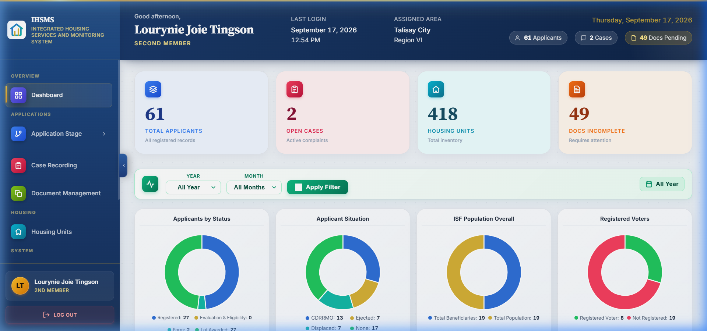

##### **Figure 4.2: Applicant Intake & Master Registration Management**
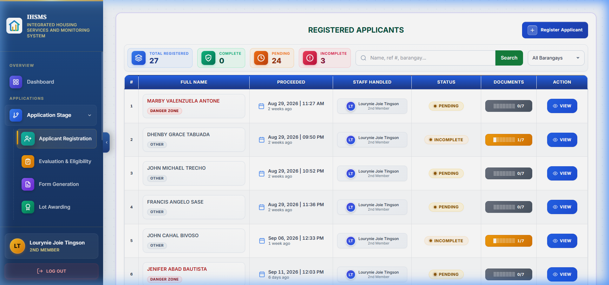

##### **Figure 4.3: Walk-in Applicant Registration Sheet**
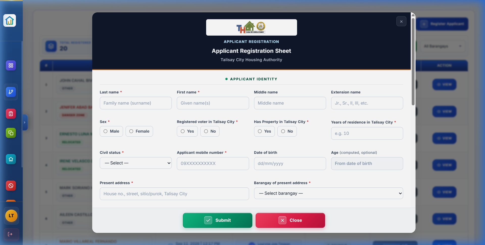

##### **Figure 4.4: Digital Document Vault & Scanner Checklist**
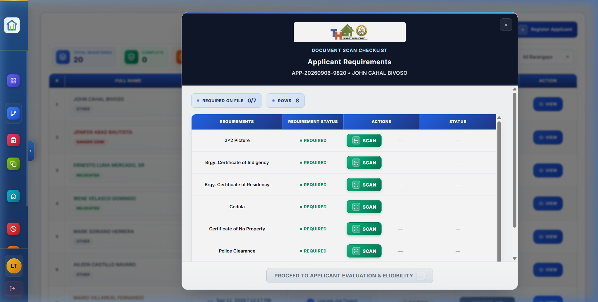

##### **Figure 4.5: Document Upload & Verification Confirmation**
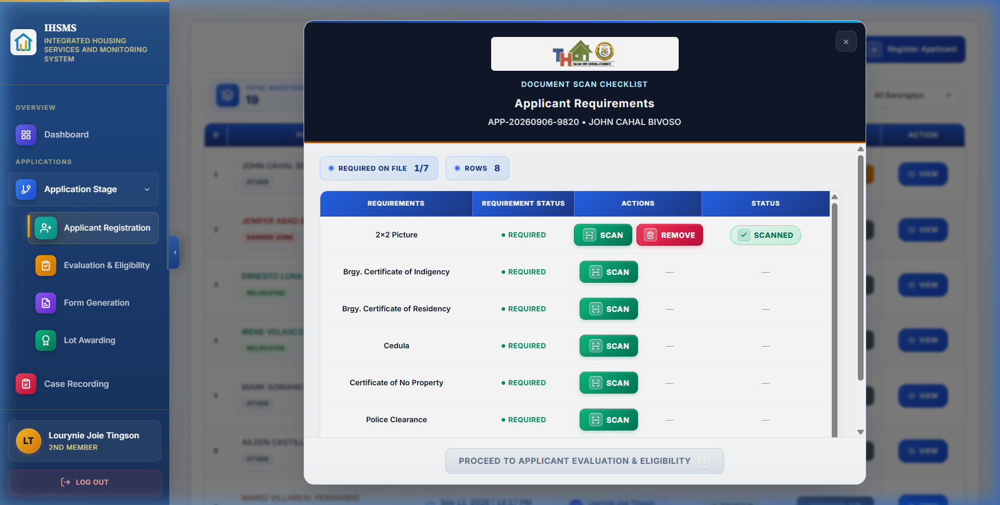

##### **Figure 4.6: Applicant Eligibility Evaluation Pipeline**
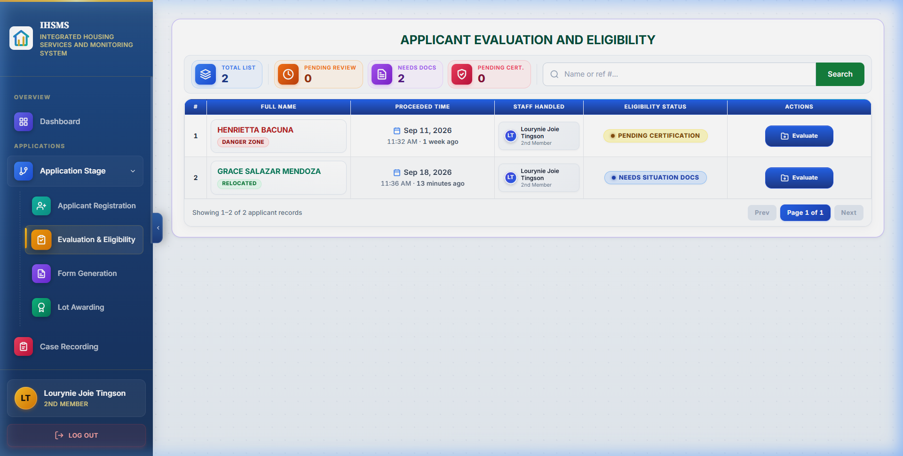

##### **Figure 4.7: Standardized Eligibility Verification Checklist**
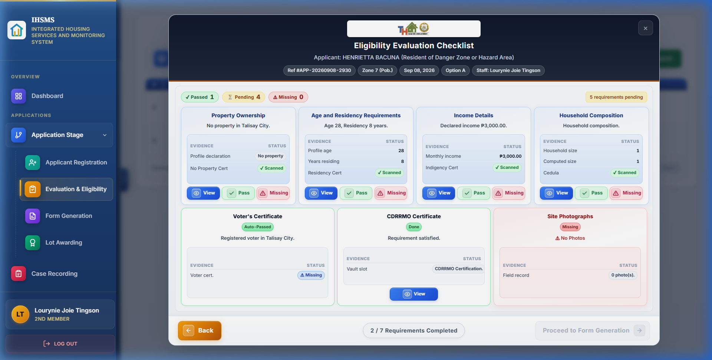

##### **Figure 4.8: Housing Unit & Relocation Site Occupancy Monitoring**
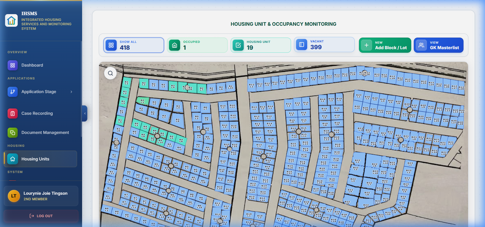

---

### **9. Prepared system-generated official housing forms, beneficiary notifications, and administrative reports.**

#### **Description & System Overview**
Engineered automated document generation and reporting modules within the IHSMS to produce standardized, official government housing application forms, orientation schedules, and administrative summaries. The module eliminates manual form typing by dynamically injecting applicant records into the official **THA Housing Application Form PDF**, tracks departmental signature cycles, and dispatches automated SMS notices to beneficiaries.

#### **Key Features & Capabilities**
- **Automated Official Housing Application Form Generation**: Dynamically renders applicant biographic data, household member rosters, and socioeconomic details into the standardized 2-page government application PDF (`APPLICATION-FORM-THA.pdf`).
- **Priority-Ordered Form Generation Queue**: Automated queue ordering qualified applicants by evaluation date and priority criteria for structured physical signing and review.
- **Orientation Scheduling & Beneficiary SMS Dispatch**: System integration dispatching automated SMS notifications with orientation dates, times, and venue details to qualified beneficiaries.
- **Cross-Module Staff Activity & Audit Trail**: Real-time logging of all applicant modifications, document approvals, lot awards, and occupancy updates for administrative transparency.

#### **Visual Evidence & Snapshots**

##### **Figure 9.1: System-Generated Form Generation Queue**
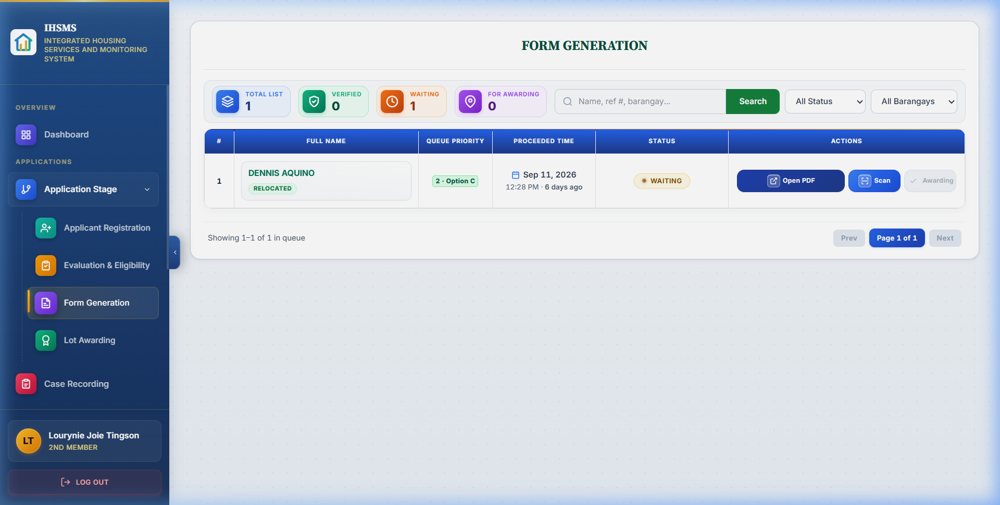

##### **Figure 9.2: System-Generated Official Housing Application Form (Page 1)**
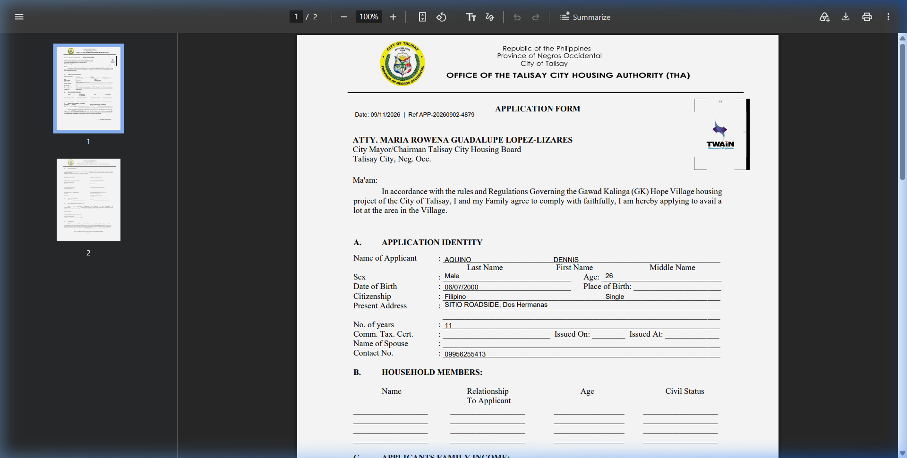

##### **Figure 9.3: System-Generated Official Housing Application Form (Page 2)**
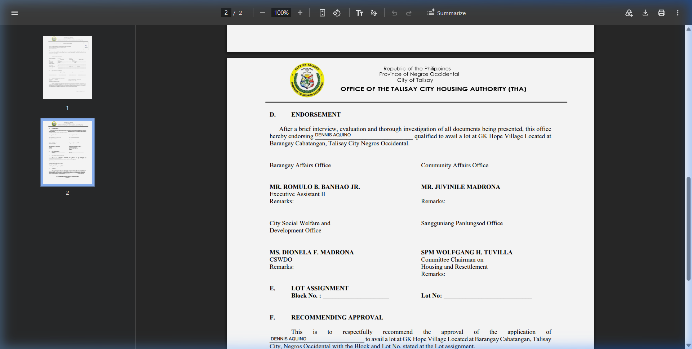

##### **Figure 9.4: Applicant Evaluation Pre-check & Verification Summary**
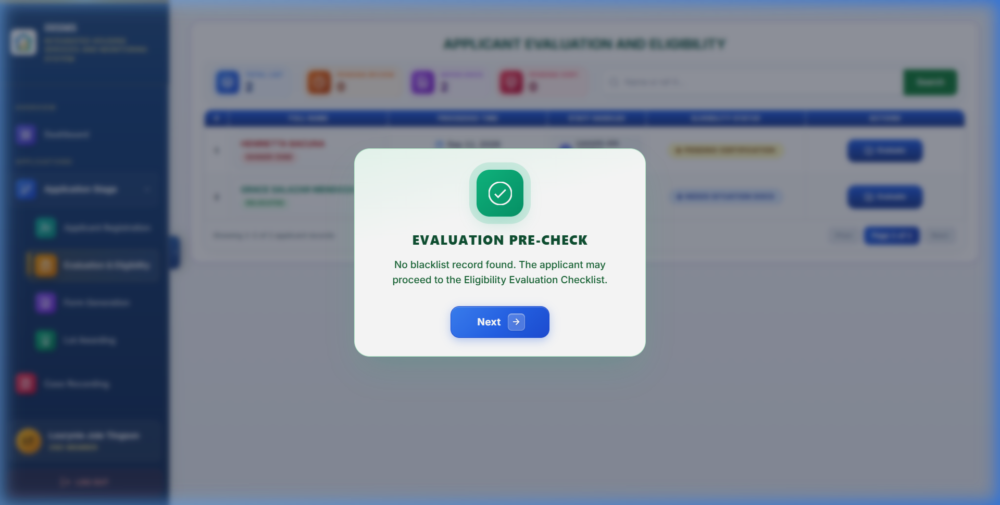

---
