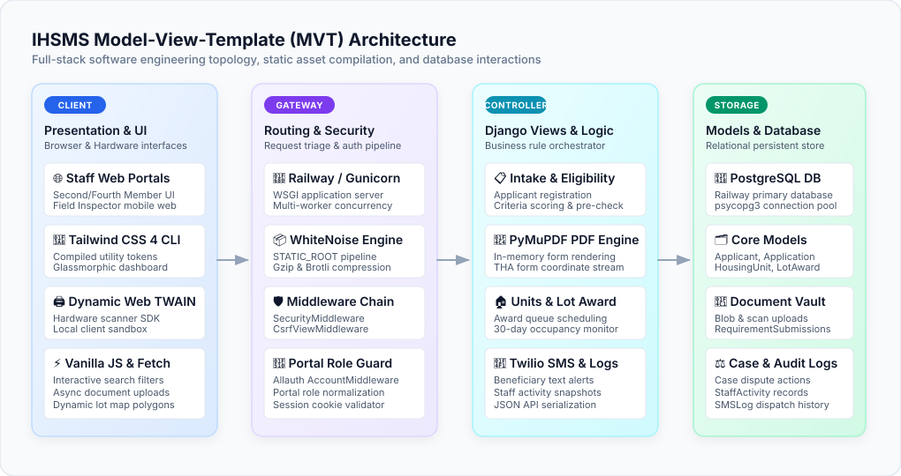
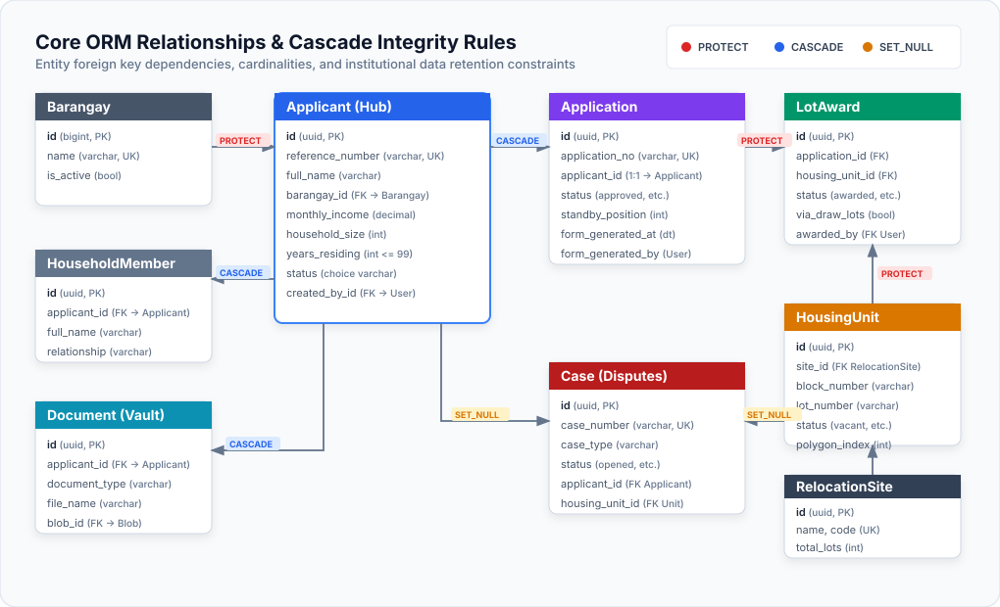
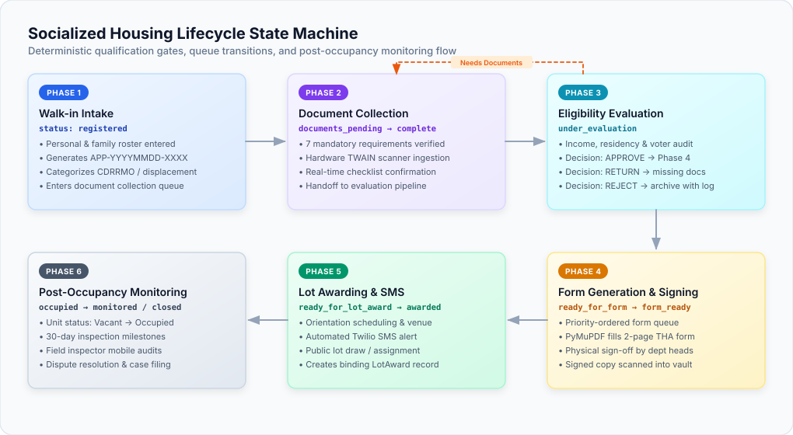

# 🏗️ Technical Architecture & System Design

> Deep-dive technical architectural document detailing data models, ORM relationships, socialized housing lifecycle state machine, automated form generation engine, and API structures for the **Integrated Housing Services and Monitoring System (IHSMS)**.

---

## 📋 Table of Contents

- [System Architecture Overview](#-system-architecture-overview)
- [Data Models & Schema Reference](#-data-models--schema-reference)
  - [1. Applicant Model (`intake.Applicant`)](#1-applicant-model-intakeapplicant)
  - [2. Application Model (`applications.Application`)](#2-application-model-applicationsapplication)
  - [3. HousingUnit Model (`units.HousingUnit`)](#3-housingunit-model-unitshousingunit)
  - [4. LotAward Model (`units.LotAward`)](#4-lotaward-model-unitslotaward)
  - [5. Case Model (`cases.Case`)](#5-case-model-casescase)
- [ORM Relationships & Cascade Rules](#-orm-relationships--cascade-rules)
- [Socialized Housing Lifecycle State Machine](#-socialized-housing-lifecycle-state-machine)
- [Automated PDF Form Generation & PyMuPDF Engine](#-automated-pdf-form-generation--pymupdf-engine)
- [AJAX & REST API Specification](#-ajax--rest-api-specification)

---

## 🏗️ System Architecture Overview

The system is engineered as a full-stack Django 6.0 web application implementing the Model-View-Template (MVT) pattern, running alongside compiled Tailwind CSS 4 CLI assets and asynchronous JSON endpoints:


> ✏️ **Draw.io Source File:** [`docs/mvt_architecture.drawio`](docs/mvt_architecture.drawio) *(Editable in [Draw.io / app.diagrams.net](https://app.diagrams.net/))*

### Architecture Highlights
- **Presentation Layer**: Django template engine enhanced by Tailwind CSS 4, Heroicons, and Lucide icons. Dynamic client-side interactions utilize Vanilla JavaScript and Fetch API for modal forms, filtering, and scanner orchestration.
- **Application Logic**: Role-gated views protected by `@login_required` and custom portal role middleware (`Second Member`, `Fourth Member`, `Field Inspector`).
- **Data Persistence**: Relational schema powered by PostgreSQL (production on Railway) and SQLite (local dev), managed through Django ORM migrations.
- **Static & Media Serving**: WhiteNoise for high-performance static asset streaming; secure local storage with PyMuPDF document vault sanitization.
- **External Integrations**: Google OAuth 2.0 via `django-allauth`, Twilio Programmable SMS API for applicant notifications, and local Dynamic Web TWAIN hardware scanner bridge.

---

## 🗄️ Data Models & Schema Reference

The core domain consists of interconnected models across `intake`, `applications`, `units`, and `cases`:

### 1. Applicant Model (`intake.Applicant`)

The primary hub entity representing an individual citizen applying for socialized housing in Talisay City.

| Field Name | Django Field Type | Constraints & Options | Description |
|---|---|---|---|
| `id` | `UUIDField` | Primary Key, `default=uuid.uuid4`, Editable=False | Universally unique applicant identifier |
| `reference_number` | `CharField(max_length=50)` | Unique, Indexed | Generated tracking code (e.g., `APP-20260829-8245`) |
| `first_name` | `CharField(max_length=100)` | Required | Applicant given name |
| `last_name` | `CharField(max_length=100)` | Required, Indexed | Applicant family name |
| `middle_name` | `CharField(max_length=100)` | Blank=True | Applicant middle name |
| `barangay` | `ForeignKey(Barangay)` | `on_delete=models.PROTECT`, Related=`applicants` | Origin barangay within Talisay City |
| `monthly_income` | `DecimalField(max_digits=12, decimal_places=2)` | Default: 0.00 | Declared monthly household income |
| `years_residing` | `PositiveIntegerField` | CheckConstraint: `years_residing <= 99` | Length of residency in Talisay City |
| `household_size` | `PositiveIntegerField` | Default: 1 | Number of co-habitating family members |
| `status` | `CharField(max_length=30)` | Choices: `registered`, `evaluating`, `form_ready`, `lot_awarded`, `archived` | Lifecycle stage of the applicant |
| `situation` | `CharField(max_length=50)` | Choices: `cdrmmo`, `ejected`, `displaced`, `none` | Special displacement circumstance |
| `registered_voter` | `BooleanField` | Default: False | Talisay City voter registration status |
| `created_by` | `ForeignKey(User)` | `on_delete=models.SET_NULL`, Null=True | Staff user who recorded initial intake |
| `created_at` | `DateTimeField` | `auto_now_add=True`, Indexed | Initial walk-in registration timestamp |
| `updated_at` | `DateTimeField` | `auto_now=True` | Timestamp of last record update |

---

### 2. Application Model (`applications.Application`)

Formal government application record created when an applicant clears preliminary screening.

| Field Name | Django Field Type | Constraints & Options | Description |
|---|---|---|---|
| `id` | `UUIDField` | Primary Key, `default=uuid.uuid4` | Unique application instance identifier |
| `application_number` | `CharField(max_length=50)` | Unique, Indexed | Official government application number |
| `applicant` | `OneToOneField(Applicant)` | `on_delete=models.CASCADE`, Related=`application` | 1-to-1 linkage to the applicant record |
| `status` | `CharField(max_length=30)` | Choices: `pending`, `reviewed`, `approved`, `standby`, `rejected` | Evaluation & approval decision state |
| `standby_position` | `PositiveIntegerField` | Null=True, Blank=True | Priority queue order for lot awarding |
| `form_generated_at` | `DateTimeField` | Null=True, Blank=True | Timestamp when official PDF was generated |
| `form_generated_by` | `ForeignKey(User)` | `on_delete=models.SET_NULL`, Null=True | Staff user who generated the PDF |
| `signed_form_uploaded_at` | `DateTimeField` | Null=True, Blank=True | Timestamp when physically signed form was returned |
| `created_at` | `DateTimeField` | `auto_now_add=True` | Record creation timestamp |

---

### 3. HousingUnit Model (`units.HousingUnit`)

Physical housing unit inventory in a Talisay City relocation site (e.g., GK Cabatangan).

| Field Name | Django Field Type | Constraints & Options | Description |
|---|---|---|---|
| `id` | `UUIDField` | Primary Key, `default=uuid.uuid4` | Unique unit identifier |
| `site` | `ForeignKey(RelocationSite)` | `on_delete=models.PROTECT`, Related=`units` | Relocation project site |
| `block_number` | `CharField(max_length=20)` | Required, Indexed | Relocation site block identifier |
| `lot_number` | `CharField(max_length=20)` | Required, Indexed | Relocation site lot identifier |
| `status` | `CharField(max_length=30)` | Choices: `vacant`, `awarded`, `occupied`, `under_inspection`, `blacklisted` | Unit occupancy status |
| `plan_polygon_index` | `IntegerField` | Null=True, Blank=True | SVG polygon index on interactive site map |
| `created_at` | `DateTimeField` | `auto_now_add=True` | Record creation timestamp |

---

### 4. LotAward Model (`units.LotAward`)

Binding award record linking an approved application to an allocated housing unit.

| Field Name | Django Field Type | Constraints & Options | Description |
|---|---|---|---|
| `id` | `UUIDField` | Primary Key, `default=uuid.uuid4` | Unique award assignment ID |
| `application` | `ForeignKey(Application)` | `on_delete=models.PROTECT`, Related=`lot_awards` | Associated approved application |
| `housing_unit` | `ForeignKey(HousingUnit)` | `on_delete=models.PROTECT`, Related=`lot_awards` | Specific unit assigned |
| `status` | `CharField(max_length=30)` | Choices: `awarded`, `confirmed`, `revoked`, `transferred` | Legal status of the award |
| `via_draw_lots` | `BooleanField` | Default: True | Whether assigned via public lot drawing |
| `awarded_by` | `ForeignKey(User)` | `on_delete=models.SET_NULL`, Null=True | Housing authority officer in charge |
| `awarded_date` | `DateField` | `auto_now_add=True` | Official date of award ceremony |

---

### 5. Case Model (`cases.Case`)

Community dispute, unauthorized occupancy, or compliance case linked to an applicant or unit.

| Field Name | Django Field Type | Constraints & Options | Description |
|---|---|---|---|
| `id` | `UUIDField` | Primary Key, `default=uuid.uuid4` | Unique case record ID |
| `case_number` | `CharField(max_length=50)` | Unique, Indexed | Formal docket number (e.g., `CASE-2026-0042`) |
| `case_type` | `CharField(max_length=50)` | Choices: `dispute`, `illegal_occupancy`, `abandonment`, `damage`, `other` | Classification of case |
| `status` | `CharField(max_length=30)` | Choices: `opened`, `under_review`, `hearing_scheduled`, `resolved`, `escalated` | Case resolution workflow status |
| `applicant` | `ForeignKey(Applicant)` | `on_delete=models.SET_NULL`, Null=True, Related=`cases` | Associated citizen subject or complainant |
| `housing_unit` | `ForeignKey(HousingUnit)` | `on_delete=models.SET_NULL`, Null=True, Related=`cases` | Associated physical unit in question |
| `opened_at` | `DateTimeField` | `auto_now_add=True` | Date and time case was filed |

---

## 🔗 ORM Relationships & Cascade Rules


> ✏️ **Draw.io Source File:** [`docs/orm_relationships.drawio`](docs/orm_relationships.drawio) *(Editable in [Draw.io / app.diagrams.net](https://app.diagrams.net/))*

### Data Integrity & Cascade Policies
- **`Applicant -> Barangay` (`PROTECT`)**: Deleting a reference barangay is blocked by the database engine if any registered applicants or relocation sites reside in it.
- **`Application -> Applicant` (`CASCADE`)**: Removing an applicant purge cascade removes their secondary application and queue records.
- **`LotAward -> HousingUnit & Application` (`PROTECT`)**: Prevents accidental deletion of awarded housing inventory or application files that hold legal allocation standing.
- **`Document -> Applicant` (`CASCADE`)**: Uploaded vault files and blobs belong strictly to the applicant lifecycle.
- **`Case -> Applicant & HousingUnit` (`SET_NULL`)**: Retains historical legal dispute records even if an applicant leaves the program or a unit is reclassified.
- **`Audit / Log Records -> User` (`SET_NULL`)**: Staff turnover or account decommissioning never erases historical logs, activity snapshots, or signature records.

---

## 🔄 Socialized Housing Lifecycle State Machine

The socialized housing allocation pipeline enforces a deterministic 6-phase qualification and award state machine:


> ✏️ **Draw.io Source File:** [`docs/housing_lifecycle_state_machine.drawio`](docs/housing_lifecycle_state_machine.drawio) *(Editable in [Draw.io / app.diagrams.net](https://app.diagrams.net/))*

### State Transition Logic:
1. **Intake (`registered`)**: Walk-in citizen registered with basic biometrics and demographic data. Reference number generated.
2. **Document Vault (`documents_pending` → `documents_complete`)**: Mandatory requirements collected and scanned via local hardware TWAIN scanner or file upload. System validates completeness checklist.
3. **Evaluation (`under_evaluation`)**: Staff review applicant income, residency, voter credentials, and displacement priority:
   - **Approve**: Moves applicant to `ready_for_form`.
   - **Needs Documents**: Returns applicant to document queue with flagged checklist items.
   - **Disqualify**: Marks as ineligible with documented legal rationale.
4. **Form Generation (`ready_for_form` → `form_generated`)**: PyMuPDF injects records into the official 2-page THA application form. Downloaded for physical department head signatures.
5. **Awarding Queue (`ready_for_lot_award` → `awarded`)**: Signed form scanned back into system. Staff schedule orientation, trigger automated Twilio SMS notice, and execute lot award.
6. **Post-Occupancy (`occupied`)**: Housing unit marked occupied. Starts 30-day monitoring cycle with site visits, progress verification, and compliance checks.

---

## 📄 Automated PDF Form Generation & PyMuPDF Engine

IHSMS replaces manual typewriter and spreadsheet form filling with an automated PDF rendering engine implemented in `applications/application_form_pdf.py` using **PyMuPDF (`fitz`)**:

```python
# Conceptual implementation excerpt from applications/application_form_pdf.py
import fitz  # PyMuPDF
from io import BytesIO

def generate_tha_application_form(applicant, application):
    """Dynamically fills the official 2-page government APPLICATION-FORM-THA.pdf."""
    template_path = "static/pdf_templates/APPLICATION-FORM-THA.pdf"
    doc = fitz.open(template_path)
    page1 = doc[0]
    
    # Text injection with calibrated absolute coordinates
    page1.insert_text((142, 118), applicant.reference_number, fontsize=10, fontname="helv")
    page1.insert_text((142, 154), applicant.full_name.upper(), fontsize=11, fontname="helv-bold")
    page1.insert_text((420, 154), applicant.barangay.name, fontsize=10, fontname="helv")
    page1.insert_text((142, 192), f"PHP {applicant.monthly_income:,.2f}", fontsize=10, fontname="helv")
    
    # Checkbox marks for situation criteria
    if applicant.situation == "cdrmmo":
        page1.insert_text((310, 230), "X", fontsize=12, fontname="helv-bold")
        
    # Household members table injection
    y_offset = 320
    for member in applicant.household_members.all()[:6]:
        page1.insert_text((85, y_offset), member.full_name, fontsize=9, fontname="helv")
        page1.insert_text((290, y_offset), member.relationship, fontsize=9, fontname="helv")
        page1.insert_text((420, y_offset), str(member.age), fontsize=9, fontname="helv")
        y_offset += 18

    output_stream = BytesIO()
    doc.save(output_stream)
    doc.close()
    output_stream.seek(0)
    return output_stream
```

### Key Technical Advantages:
- **Vector Fidelity**: Modifies official government PDF forms directly without rasterizing, preserving crisp typography for print and scanning.
- **In-Memory Streaming**: Operates entirely within `io.BytesIO` streams, eliminating temporary disk I/O vulnerabilities.
- **Deterministic Coordinate Mapping**: Exact pixel-mapped coordinates ensure alignment with pre-printed legal forms.

---

## ⚡ AJAX & REST API Specification

Asynchronous operations adhere to a predictable JSON envelope:

### Success Response Format (`200 OK`)
```json
{
  "success": true,
  "message": "Applicant eligibility approved successfully.",
  "data": {
    "reference_number": "APP-20260829-8245",
    "status": "ready_for_form",
    "next_queue": "/applications/staff/second_member/ready-for-form/"
  }
}
```

### Error Response Format (`400 Bad Request` / `403 Forbidden` / `404 Not Found`)
```json
{
  "success": false,
  "message": "Unable to proceed to form generation. Missing required documents.",
  "errors": {
    "missing_documents": [
      "Certificate of No Property",
      "Sketch of House Location"
    ]
  }
}
```

### Key Endpoints:
- `POST /intake/applicants/register/`: Walk-in applicant creation.
- `POST /documents/scan/upload/`: Asynchronous document vault upload.
- `POST /applications/<id>/evaluate/`: Evaluation decision submission.
- `GET /applications/<id>/generate-pdf/`: In-memory PDF streaming.
- `POST /units/<id>/award/`: Formal lot assignment and Twilio SMS trigger.
