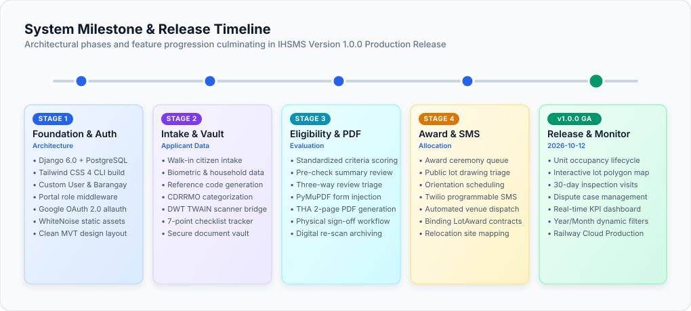

# 📜 Changelog

All notable changes to the **Integrated Housing Services and Monitoring System (IHSMS)** will be documented in this file.

The format is based on [Keep a Changelog](https://keepachangelog.com/en/1.1.0/), and this project adheres to [Semantic Versioning](https://semver.org/spec/v2.0.0.html).

---

## [1.1.0] - 2026-10-21

### ✨ Added & Improved

#### 📥 Household Member Demographics & Validation
- **Household Member Birthdate Field**: Added optional datepicker input (`Flatpickr`) for each household member in the walk-in registration and update modals.
- **Dynamic Age Auto-Calculation**: Member age is automatically computed in real time upon selecting a birthdate; age input automatically transitions to read-only when birthdate is populated.
- **Generational Age Validation**: Added cross-generational validation rules ensuring:
  - An applicant's age is greater than any declared child's age (`applicant_age > child_age`).
  - An applicant's age is less than any declared parent's age (`applicant_age < parent_age`).
- **Relationship Dropdown Alignment**: Removed `live_in_partner` from new registration dropdown options while preserving choice definition for legacy database records.
- **Cascading Place of Birth**: Added two-stage Philippine Standard Geographic Code (PSGC) cascading selectors (Province → City/Municipality) for applicant birthplaces.
- **Test Suite Expansion**: Added unit tests covering household member birthdate parsing, auto-age calculations, and relationship cross-validation.

---

## [1.0.0] - 2026-10-12

> ✏️ **Draw.io Source File:** [`docs/changelog_timeline.drawio`](docs/changelog_timeline.drawio) *(Editable in [Draw.io / app.diagrams.net](https://app.diagrams.net/))*

### 🚀 Initial Production Release

#### 📋 Applicant Intake & Walk-in Registration
- **Citizen Walk-in Registration**: Centralized intake capturing applicant biometrics, demographic profiles, household rosters, and income declarations.
- **Automated Tracking Codes**: System-generated reference numbers (`APP-YYYYMMDD-XXXX`) assigned to each applicant record upon intake.
- **Displacement Classification**: Native classification tags for CDRRMO disaster victims, court-ejected occupants, infrastructure-displaced families, and standard applicants.
- **Geographical Boundary Validation**: Barangay model integration with Talisay City reference dataset and active residency checks.

#### 📄 Digital Document Vault & Scanner Integration
- **Dynamic Web TWAIN Hardware Bridge**: Direct scanner SDK integration enabling local flatbed and feed scanner document ingestion directly from the browser.
- **Local Hardware Sandbox Isolation**: Scanner service communicates strictly via localhost endpoints, isolating raw scanner drivers from remote networks.
- **Mandatory Requirements Checklist**: Real-time 7-point checklist tracking (2x2 Photo, Indigency Certificate, Residency Certificate, Cedula, Certificate of No Property, Police Clearance, House Sketch).
- **PyMuPDF Document Sanitizer**: Server-side PDF validation, page-count checking, and document vault storage with blob detachment.

#### ⚖️ Multi-Tier Eligibility Evaluation
- **Standardized Qualification Engine**: Interactive staff evaluation panel scoring applicant income thresholds, residency length, voter registration, and priority criteria.
- **Structured Review Decisions**: Three-way evaluation triage: `Approve` (routes to Form Generation queue), `Return for Documents` (flags missing checklist items), and `Disqualify` (records legal rationale).
- **Evaluation Pre-Check Summary**: High-level candidate review cards summarizing applicant qualification standing before final committee sign-off.

#### 📝 Automated Official Form Generation
- **PyMuPDF Coordinate Injection Engine**: In-memory text and checkbox placement onto the standardized 2-page government application form (`APPLICATION-FORM-THA.pdf`).
- **Priority-Ordered Queue**: Automated FIFO queue ordering evaluated candidates by approval timestamp and disaster vulnerability priority.
- **Physical Signature Workflow**: Printable PDF output for departmental heads' physical sign-off, paired with digital re-upload verification.

#### 🎯 Lot Awarding & Beneficiary Notifications
- **Award Ceremony Queue**: Structured queue for managing public lot-drawing sessions and unit allocation ceremonies.
- **Automated Semaphore SMS Engine**: Live SMS dispatch sending orientation schedules, dates, times, and venue notices directly to beneficiaries.
- **Binding Legal Award Records**: Creation of immutable `LotAward` records bridging applications to designated relocation site lots.

#### 🏘️ Housing Unit Inventory & Relocation Monitoring
- **Relocation Site Management**: Complete database mapping for relocation projects (such as GK Cabatangan) with block and lot inventories.
- **Unit Occupancy Lifecycle**: Status tracking across `Vacant`, `Awarded`, `Occupied`, `Under Inspection`, and `Blacklisted`.
- **Interactive SVG Site Map**: Visual lot plan map with polygon indexing (`plan_polygon_index`) for graphical unit inspection.
- **30-Day Milestone Inspection**: Post-occupancy monitoring cycle tracking construction progress, occupancy compliance, and unauthorized transfers.

#### 📊 Real-Time Analytics & Statistical Dashboard
- **Demographic KPI Metrics**: Dynamic statistics cards tracking Total Applicants, ISF Population, CDRRMO Affected Families, and Registered Voters.
- **Occupancy & Inventory Analytics**: Visual breakdown of vacant vs. occupied units, case aging distributions, and top barangay origins.
- **Multi-Level Date Filters**: Interactive Year and Month dropdown filtering updating all dashboard analytics without full page reloads.

#### 🔐 Role-Based Access Control & Security Portal
- **Dedicated Staff Portals**: Role-gated workflows customized for `Second Member`, `Fourth Member`, `Caretaker (Ronda)`, and `Field Staff`.
- **Google OAuth 2.0 Integration**: Social login powered by `django-allauth` with verified email account linking and cryptographic state verification.
- **Defense-in-Depth Security**: Full CSRF protection across 100% of POST endpoints, `ALLOWED_HOSTS` verification, proxy SSL header trust, and zero hardcoded credentials.

#### 📜 Open Source & Community Standards
- **Architectural Vector Diagrams**: Dedicated Draw.io vector assets (`mvt_architecture.drawio.svg`, `orm_relationships.drawio.svg`, `housing_lifecycle_state_machine.drawio.svg`, `security_architecture.drawio.svg`, `contribution_workflow.drawio.svg`, `pr_lifecycle.drawio.svg`, `conduct_enforcement.drawio.svg`).
- **Comprehensive Governance Documentation**: Standardized repository files including `CODE_OF_CONDUCT.md`, `CONTRIBUTING.md`, `SECURITY.md`, `LICENSE`, `ACCOMPLISHMENT_REPORT.md`, and `ARCHITECTURE.md`.
