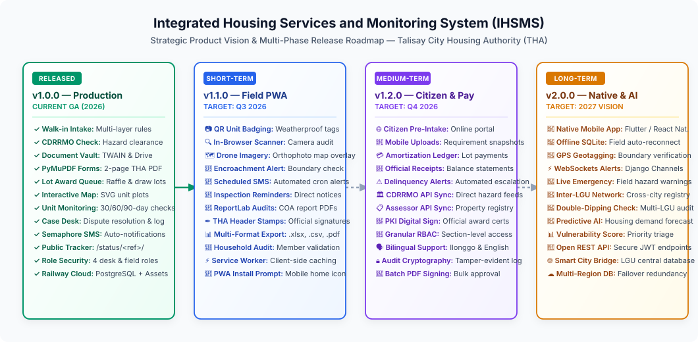

# 🗺️ System Feature Roadmap

> Strategic product vision and feature roadmap for the **Integrated Housing Services and Monitoring System (IHSMS)** — Talisay City Housing Authority (THA).

🌐 **Live Demo:** [ihsms.up.railway.app](https://ihsms.up.railway.app/) | 📦 **Repository:** [TheUnshackled1/capstone-talisay_housing](https://github.com/TheUnshackled1/capstone-talisay_housing)

---

## 📋 Table of Contents

- [Roadmap Overview](#-roadmap-overview)
- [Released Milestones](#-released-milestones)
  - [[v1.0.0] - Initial Production Release (Current)](#v100---initial-production-release-current)
- [Short-Term Roadmap (v1.1.0 — Q3 2026)](#-short-term-roadmap-v110--q3-2026)
  - [1. QR Code Lot Badging & Mobile Web Scanner](#-1-qr-code-lot-badging--mobile-web-scanner)
  - [2. High-Resolution Drone Orthophoto Map Layer](#-2-high-resolution-drone-orthophoto-map-layer)
  - [3. Automated SMS Document Reminders & Inspection Notices](#-3-automated-sms-document-reminders--inspection-notices)
  - [4. COA Audit Report Generation & Export Controls](#-4-coa-audit-report-generation--export-controls)
- [Medium-Term Roadmap (v1.2.0 — Q4 2026)](#-medium-term-roadmap-v120--q4-2026)
  - [1. Citizen Online Self-Service Intake Portal](#-1-citizen-online-self-service-intake-portal)
  - [2. Monthly Housing Amortization & Billing Ledger](#-2-monthly-housing-amortization--billing-ledger)
  - [3. CDRRMO & City Assessor Direct API Sync](#-3-cdrrmo--city-assessor-direct-api-sync)
  - [4. Cryptographic Digital Signatures & Legal Verification](#-4-cryptographic-digital-signatures--legal-verification)
- [Long-Term Vision (v2.0.0 — 2027)](#-long-term-vision-v200--2027)
  - [1. Native Offline-First Mobile Companion App](#-1-native-offline-first-mobile-companion-app)
  - [2. Real-Time WebSockets Alerts & Event Streams](#-2-real-time-websockets-alerts--event-streams)
  - [3. Inter-LGU Social Housing Registry Sync & AI Demand Analytics](#-3-inter-lgu-social-housing-registry-sync--ai-demand-analytics)
- [Strategic Architecture & Tech Stack Evolution](#-strategic-architecture--tech-stack-evolution)
- [Suggesting New Features](#-suggesting-new-features)

---

## 📋 Roadmap Overview

This roadmap defines the continuous technical evolution and strategic product milestones for the **Talisay City Housing Authority (THA) Integrated Housing Services and Monitoring System (IHSMS)**. It outlines core functionality already deployed to production as well as phased enhancements designed to improve citizen accessibility, accelerate field caretaker workflows, and automate municipal compliance reporting.

> ✏️ **Draw.io Source File:** [`docs/roadmap_milestones.drawio`](docs/roadmap_milestones.drawio) *(Editable in [Draw.io / app.diagrams.net](https://app.diagrams.net/))*

---

## ✅ Released Milestones

### [v1.0.0] - Initial Production Release (Current)

The initial production release successfully digitized the end-to-end socialized housing lifecycle for the Talisay City Housing Authority, replacing paper folders and disconnected spreadsheets with a unified, role-based platform.

- [x] **Walk-in Applicant Intake & Registration**:
  - Modal-driven registration capturing applicant personal information, spouse details, household roster, and income.
  - Cascading Philippine Standard Geographic Code (PSGC) birthplace selectors (Province → City/Municipality).
  - 5-layer eligibility pre-screening: income ceiling threshold, 5+ years Talisay residency verification, property ownership check, CDRRMO hazard verification, and administrative blacklist check.
  - Instant duplicate applicant detection using phonetic and exact matching algorithms.
- [x] **Document Vault Management**:
  - Centralized digital vault tracking mandatory 7-point application requirements (Barangay Clearance, Certificate of Indigency, Income Proof, Valid IDs, Marriage Certificate, etc.).
  - Hardware scanner integration via Dynamic Web TWAIN for instant physical paper digitizing.
  - Cloud upload integration via Google Drive OAuth.
- [x] **Evaluation & Official Form Generation**:
  - Deep eligibility evaluation workflows with triage scoring (Approved, Waitlisted, Disqualified).
  - High-precision PDF injection engine using PyMuPDF (`fitz`), automatically generating the official 2-page Talisay Housing Authority Application Form with exact coordinate alignment.
- [x] **Lot Awarding & Queue Management**:
  - Transparent public draw-lots queue and orientation session scheduler.
  - Assignment of approved beneficiaries to specific housing blocks and lots across Talisay relocation sites.
  - Generation of binding Lot Award legal agreements.
- [x] **Housing Unit Monitoring**:
  - Interactive SVG polygon lot map displaying real-time occupancy status (Vacant, Awarded, Occupied, Under Construction, In Dispute).
  - 30-day, 60-day, and 90-day post-award construction and occupancy inspection workflow milestones.
  - Caretaker (Ronda) mobile field portal for logging unit inspections and compliance notices.
- [x] **Community Case Management**:
  - Structured desk and field complaint logging for boundary disputes, illegal subleasing, and abandoned units.
  - Case timeline event histories, photographic evidence attachments, and formal field settlement recording.
- [x] **Role-Based Security & Audit Trails**:
  - Four isolated staff portal positions: Second Member, Fourth Member, Ronda/Caretaker, and Field Staff.
  - Google Workspace OAuth and local database authentication with persistent session cookies.
  - Comprehensive staff activity logging (`staff_activity.py`) recording all data modifications.
- [x] **Automated Citizen Notifications**:
  - Semaphore SMS gateway integration sending automatic tracking codes upon walk-in intake.
  - SMS updates on eligibility review outcomes and lot awarding orientation schedules.
  - Public unauthenticated applicant status tracker (`/status/<ref>/`) accessible directly from SMS links.
- [x] **Cloud Production Deployment**:
  - Production-ready deployment on Railway with PostgreSQL database, WhiteNoise static asset delivery, and automated schema migrations.

---

## 🎯 Short-Term Roadmap (`v1.1.0` — Q3 2026)

Focus: **Field Mobile PWA & Offline Inspections, QR Code Lot Badging & Biometric Identity**

### 📷 1. QR Code Lot Badging & Mobile Web Scanner
- **Weatherproof QR Asset Badges**: Automatically generate printable high-contrast QR code badges for every awarded relocation lot.
- **In-Browser Camera Scanner**: Integrated HTML5 camera scanner in the Caretaker/Ronda portal enabling staff to scan physical unit badges and instantly pull up occupant profiles, award dates, and inspection histories.
- **Beneficiary QR ID Cards**: Printable digital ID badges for household heads to present during physical document submissions or community assemblies.

### 🗺️ 2. High-Resolution Drone Orthophoto Map Layer
- **Aerial Drone Map Overlay**: Integrate geo-referenced drone orthophoto tiles over the interactive SVG lot map to provide high-detail photographic context of site developments.
- **Boundary Encroachment Detection**: Visual comparison tools enabling staff to detect unpermitted lot expansions or unauthorized structures along danger zone buffer lines.

### 📧 3. Automated SMS Document Reminders & Inspection Notices
- **Background Cron Engine**: Scheduled Celery/cron tasks scanning for applicants with pending document requirements nearing deadline thresholds.
- **Automated Broadcast Notices**: Automated Semaphore SMS reminders notifying beneficiaries of scheduled field inspection dates and community meetings.
- **SMS Delivery Tracking**: Real-time delivery status tracking and fallback SMS retry queues.

### 📄 4. COA Audit Report Generation & Export Controls
- **Commission on Audit (COA) Compliance Reports**: Generate official summary rolls of awarded socialized housing units, eligibility distributions, and vacant inventories via ReportLab.
- **Official Header & Signature Blocks**: Automated injection of institutional THA crests, official city seal, and signature sign-off lines for department heads.
- **Multi-Format Data Exports**: Direct one-click export buttons on all data tables for `.xlsx`, `.csv`, and `.pdf` formats.

---

## 🔮 Medium-Term Roadmap (`v1.2.0` — Q4 2026)

Focus: **Citizen Self-Service Portal, Amortization Ledger & Inter-Agency APIs**

### 🌐 1. Citizen Online Self-Service Intake Portal
- **Public Pre-Registration Portal**: Allow Talisay City residents to initiate housing applications from home via mobile web browser.
- **Mobile Photo Requirement Uploads**: Applicants can take smartphone photos of their barangay clearances and IDs for preliminary eligibility review before visiting city hall.
- **Appointment Scheduling Engine**: Self-service time slot booking to reduce physical queues at the THA front desk.

### 💳 2. Monthly Housing Amortization & Billing Ledger
- **Beneficiary Financial Accounts**: Dedicated ledger tracking monthly lot amortization dues, down payments, and remaining balances.
- **Official Receipt (OR) Logging**: Cashier portal for recording payment receipts, generating digital statements of account, and calculating interest or penalties.
- **Automated Delinquency Escalation**: Multi-tier alert workflow for units with 3+ months unpaid amortization, generating automated reminder notices.

### 🏛️ 3. CDRRMO & City Assessor Direct API Sync
- **Live CDRRMO Hazard Data Sync**: Direct API integration with the Talisay City Disaster Risk Reduction Management Office to pull official riverbank, landslide, and storm surge hazard maps automatically.
- **City Assessor Property Registry Validation**: Automated real-time query against the Talisay City Assessor database to verify real property ownership and validate Layer 3 eligibility instantly.

### 🔏 4. Cryptographic Digital Signatures & Legal Verification
- **PKI Digital Signatures**: Cryptographic digital signing for THA executives on Notices of Award, Transfer Certificates, and Disqualification Notices.
- **Public Verification QR Seals**: Verification QR codes on issued documents allowing external parties (banks, utility companies, courts) to verify document authenticity online.

---

## 🚀 Long-Term Vision (`v2.0.0` — 2027)

Focus: **Native Offline-First Mobile Companion App, Real-Time WebSockets & Cross-LGU Housing AI**

### 📱 1. Native Offline-First Mobile Companion App
- **Cross-Platform Mobile App**: Native Android and iOS application (Flutter) built for field caretakers, inspectors, and CDRRMO emergency personnel.
- **Offline SQLite Synchronization**: Full offline data capture for remote relocation sites lacking cellular signal, with automatic background synchronization upon returning to network coverage.
- **GPS Unit Geotagging & Photo Watermarking**: Automated capture of precise latitude/longitude coordinates and tamper-resistant timestamps on all field inspection photos.

### ⚡ 2. Real-Time WebSockets Alerts & Event Streams
- **Instant Desk Notifications**: Real-time in-app alert toasts powered by Django Channels and WebSockets when new cases are logged or urgent disputes arise.
- **Live Collaborative Editing**: Real-time locking and occupancy indicators preventing concurrent staff edits on identical applicant records or unit polygons.

### 🤖 3. Inter-LGU Social Housing Registry Sync & AI Demand Analytics
- **Cross-LGU Housing Network**: Secure federated data exchange with neighboring Negros Occidental local government units (Bacolod City, Silay City, Bago City) to eliminate social housing double-dipping and unauthorized multiple awards.
- **Predictive Housing Demand Modeling**: Machine learning models analyzing population growth, hazard risk profiles, and income distributions to forecast municipal housing demand 5–10 years into the future.
- **Automated Vulnerability Scoring**: Algorithmic prioritization ranking families in extreme danger zones for emergency relocation assistance.

---

## 🛠️ Strategic Architecture & Tech Stack Evolution

| Architectural Layer | Current Stack (`v1.0.0`) | Short-Term (`v1.1.0`) | Medium-Term (`v1.2.0`) | Long-Term Vision (`v2.0.0`) |
|---|---|---|---|---|
| **Backend Framework** | Django 6.0 (Python 3.12+) | Django 6.0 + Celery | Django 6.0 + Django REST Framework | Django 6.x + Django Channels |
| **Database** | PostgreSQL (Railway Cloud) | PostgreSQL + Redis Cache | PostgreSQL + Read Replica | Distributed PostgreSQL Cluster |
| **Frontend UI** | Tailwind CSS 4 + Alpine.js | Tailwind CSS 4 + PWA Service Worker | Tailwind CSS 4 + Vue.js Components | Flutter (Mobile) + Modern Web UI |
| **PDF & Documents** | PyMuPDF (`fitz`) | PyMuPDF + ReportLab | Cryptographic Signatures (PyHanko) | Automated Legal Verification API |
| **Geospatial & Maps** | Interactive SVG Polygons | SVG + Drone Orthophoto Tiles | Leaflet.js / OpenLayers GIS | Mapbox / Cesium 3D Terrain |
| **Messaging & Alerts** | Semaphore SMS Gateway | Semaphore SMS + Celery Cron | Multi-Channel (SMS + Email + Push) | WebSockets + Push Notifications |
| **Field Mobile** | Responsive Web (Chrome/Edge) | Progressive Web App (PWA) | PWA with Offline Storage | Native Flutter / React Native App |
| **Integrations** | Google OAuth + Google Drive | QR Code Scanner API | CDRRMO & Assessor REST APIs | Inter-LGU Federated Housing Network |

---

## 💡 Suggesting New Features

Have an idea for a feature or workflow enhancement not covered in this roadmap? We welcome contributions and community proposals!

1. Check our **[Contributing Guidelines](CONTRIBUTING.md)** and **[Architecture Documentation](ARCHITECTURE.md)**.
2. Open a **[Feature Request Issue](https://github.com/TheUnshackled1/capstone-talisay_housing/issues/new?template=feature_request.md)** detailing the proposed problem, workflow benefits, and user stories.
3. Review our **[Contributor Code of Conduct](CODE_OF_CONDUCT.md)** to ensure inclusive and professional collaboration.
