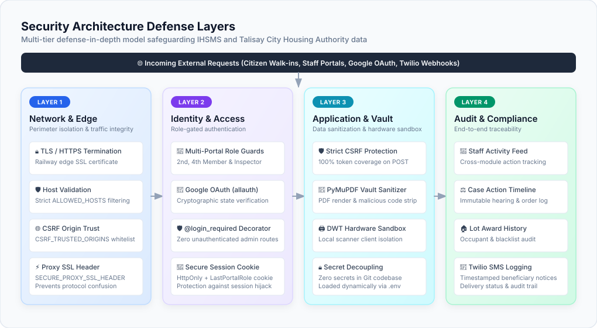

# 🛡️ Security Policy

> Security policy and vulnerability reporting guidelines for the **Integrated Housing Services and Monitoring System (IHSMS)**.

---

## 📋 Supported Versions

The table below details which versions of the system currently receive security updates and bug fixes:

| Version | Supported | Minimum Python | Minimum Django |
|---|---|---|---|
| `1.0.x` | ✅ Yes | `3.12+` | `6.0+` |
| `< 1.0` | ❌ No | — | — |

---

## 🔒 Reporting a Vulnerability

The security of the **Integrated Housing Services and Monitoring System (IHSMS)** and the integrity of sensitive citizen housing and beneficiary data is a top priority.

If you discover a security vulnerability or suspect a security flaw within the application:

1. **Do NOT open a public GitHub issue** or publicly disclose the vulnerability.
2. **Email the Security Team privately**: Send a detailed report to the system maintainer at `jtcoronel.chmsu@gmail.com` or contact the **Talisay City Housing Authority (THA)** directly.
3. **Include Key Details**:
   - Type of issue (e.g., CSRF, Authentication / Authorization Bypass, Privilege Escalation, Information Disclosure, Injection).
   - Step-by-step instructions or proof-of-concept to reproduce the issue.
   - Affected views, endpoints, forms, or templates.
   - Potential impact on applicant documents, lot allocations, or system integrity.

### ⏱️ Response Timeline

- **Acknowledgment**: Within 24 hours of receipt.
- **Assessment & Triage**: Within 48 hours.
- **Patch & Fix Release**: Critical fixes released within 7 days.

---

## 🛡️ Built-in Security Measures

> ✏️ **Draw.io Source File:** [`docs/security_architecture.drawio`](docs/security_architecture.drawio) *(Editable in [Draw.io / app.diagrams.net](https://app.diagrams.net/))*

The system enforces comprehensive multi-layer security controls out of the box:

- **CSRF Protection**: `django.middleware.csrf.CsrfViewMiddleware` active with `` across 100% of POST forms, reinforced with strict `CSRF_TRUSTED_ORIGINS` validation.
- **Role-Gated Portal Access**: Discrete staff positions (`second_member`, `fourth_member`, `field_inspector`) protected by `@login_required` decorators, portal role normalization, and view-level authorization checks.
- **Secure Google OAuth Integration**: Powered by `django-allauth` with OAuth state validation, verified email linking, and defensive callback sanitization.
- **Document Vault Sanitization**: File uploads restricted by size limits and validated MIME types; PyMuPDF handles server-side document parsing and preview generation securely.
- **Hardware Isolation for Scanner Integration**: Dynamic Web TWAIN hardware scanner interactions operate strictly inside a local desktop sandbox via localhost service communication, avoiding exposure of raw hardware drivers to remote networks.
- **Cross-Module Activity Audit Trail**: Real-time staff logging across applicant registration, qualification review, lot awards, inspection reports, and case management for complete accountability.
- **Environment & Secret Isolation**: Sensitive credentials (`SECRET_KEY`, `DATABASE_URL`, Twilio API keys, and email configs) loaded dynamically via `.env` / environment variables with zero hardcoded credentials.

---

## 📜 Disclosure Policy

We follow a **Responsible Disclosure** process. Once a reported vulnerability is fixed and verified, security advisories will be published alongside updated patch releases.
