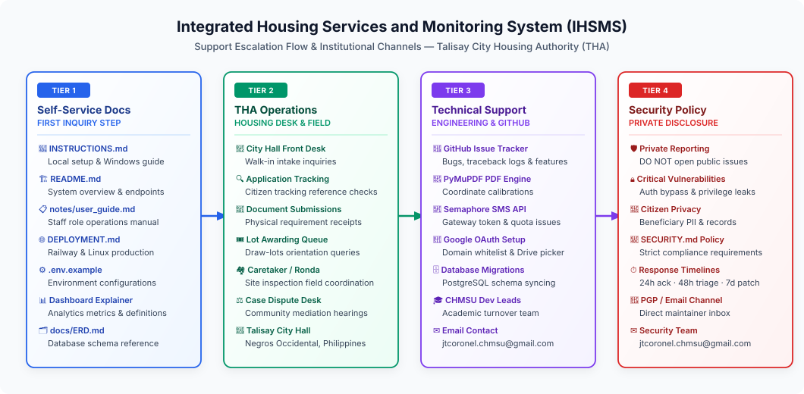

# 💬 Getting Support

> Official support channels, escalation procedures, and troubleshooting resources for the **Integrated Housing Services and Monitoring System (IHSMS)** — Talisay City Housing Authority (THA).

🌐 **Live Demo:** [ihsms.up.railway.app](https://ihsms.up.railway.app/) | 📦 **Repository:** [TheUnshackled1/capstone-talisay_housing](https://github.com/TheUnshackled1/capstone-talisay_housing)

---

## 📋 Where to Get Help


> ✏️ **Draw.io Source File:** [`docs/support_channels.drawio`](docs/support_channels.drawio) *(Editable in [Draw.io / app.diagrams.net](https://app.diagrams.net/))*

If you encounter issues, have questions, or require assistance operating the system, please consult the resources below in order:

---

### 1. 📖 Self-Service Documentation

Before opening an issue or contacting support, check the comprehensive documentation available directly in the repository:

| Document | Description |
|---|---|
| **[INSTRUCTIONS.md](INSTRUCTIONS.md)** | Step-by-step local setup, Windows installation, database configuration, Semaphore SMS settings, Google OAuth setup, and troubleshooting guide. |
| **[README.md](README.md)** | Full system overview, core module workflows, tech stack, URL routing table, and endpoint reference. |
| **[notes/user_guide.md](notes/user_guide.md)** | Staff role operational guide for Second Member, Fourth Member, Caretaker (Ronda), and Field Staff. |
| **[DEPLOYMENT.md](DEPLOYMENT.md)** | Production deployment procedures for Railway Cloud, PythonAnywhere, and Linux (Nginx + Gunicorn + PostgreSQL). |
| **[ARCHITECTURE.md](ARCHITECTURE.md)** | Deep dive into system architecture, Model-View-Template (MVT) design, and data flows. |
| **[docs/ERD.md](docs/ERD.md)** | Complete database Entity Relationship Diagram and schema reference. |
| **[notes/dashboard_analytics_explainer.md](notes/dashboard_analytics_explainer.md)** | Explanation of dashboard metric cards, analytics calculations, and status definitions. |
| **[.env.example](.env.example)** | Reference template for all environment variables and API keys. |

---

### 2. 🛡️ Security Vulnerabilities

If you discover a potential security vulnerability, authentication bypass, authorization leak, or exposed sensitive citizen data, please **do NOT open a public GitHub issue**.

Follow the confidential reporting policy detailed in **[SECURITY.md](SECURITY.md)**:
- **Email Contact**: `jtcoronel.chmsu@gmail.com`
- **Acknowledgment Window**: Within 24 hours.
- **Triage & Patch Release**: Within 48 hours to 7 business days depending on severity.

---

### 3. 🏢 Institutional Support Channels

For operational, municipal, and institutional inquiries within the Talisay City government or academic turnover partner:

#### 🏛️ Talisay City Housing Authority (THA) Operations Desk
- **Scope**: Citizen walk-in registration questions, physical requirement submissions, eligibility status inquiries, lot awarding ceremonies, and community dispute intake.
- **Office Location**: Talisay City Housing Authority, Talisay City Hall, Negros Occidental, Philippines.
- **Operating Hours**: Monday – Friday, 8:00 AM – 5:00 PM PHT.

#### 🎓 Capstone Development & Engineering Team (CHMSU)
- **Scope**: Technical bugs, server maintenance, PyMuPDF PDF coordinate recalibration, Semaphore SMS gateway configuration, and database migration support.
- **Institution**: Carlos Hilado Memorial State University (CHMSU).
- **Lead Developer Email**: `jtcoronel.chmsu@gmail.com`

---

## 🐛 Submitting a Bug Report or Feature Request

If you have confirmed a reproducible bug or would like to propose a workflow enhancement:

### Step 1: Search Existing Issues
Check the **[GitHub Issue Tracker](https://github.com/TheUnshackled1/capstone-talisay_housing/issues)** to verify that your issue or feature proposal has not already been reported.

### Step 2: Open a New Issue
Click **New Issue** on GitHub and provide the following details:

```markdown
### Description
Clear, concise summary of the bug or requested feature.

### Steps to Reproduce (For Bugs)
1. Go to '...' (e.g., Staff Portal > Register Applicant)
2. Fill out '...'
3. Click 'Submit'
4. Observe error or unexpected behavior

### Expected Behavior
What you expected to happen according to system documentation.

### Actual Behavior / Screenshots
What actually occurred (attach screenshots, console errors, or server tracebacks).

### Environment Details
- **Browser**: Chrome 124, Edge 124, Firefox 125, Safari 17
- **Operating System**: Windows 11, Ubuntu 24.04, macOS Sonoma
- **Python / Django Version**: Python 3.12+ / Django 6.0
- **Portal Role**: Second Member, Fourth Member, Caretaker, or Unauthenticated Public
```

---

## ❓ Frequently Asked Operational Questions (FAQ)

### 1. Why does Google OAuth show "Access Blocked: Your domain is not permitted"?
The system enforces strict domain whitelisting in `settings.py`. Only users with authenticated accounts under `@talisayhousing.gov.ph`, `@chmsu.edu.ph`, or authorized `@gmail.com` addresses configured in the Google Cloud Console OAuth Consent Screen can sign in. Ensure your email is registered with the system administrator.

### 2. What if a citizen does not receive their SMS tracking code?
1. Verify in `.env` that `SMS_SERVICE=semaphore` and a valid `SEMAPHORE_API_KEY` with available message credits is configured.
2. Confirm the mobile number follows the 11-digit Philippine mobile format (`09XXXXXXXXX`).
3. For local testing with `SMS_SERVICE=console`, the SMS body and 10-character tracking code are printed directly to the terminal stdout.

### 3. Why are some fields on the generated application form PDF misaligned?
The application form PDF is injected via PyMuPDF (`fitz`) using fixed point coordinates mapped to the official 2-page THA application form. If you replaced the blank base PDF template in `media/` or `static/`, coordinate calibration in `applications/application_form_pdf.py` may be required.

### 4. How long does a staff login session last?
Staff sessions are configured with a 5-hour Time-to-Live (TTL) and expire automatically upon closing the browser window for security compliance. If your session expires while editing, simply log back in; unsubmitted modal data may need to be re-entered.

---

Thank you for helping maintain a transparent, reliable, and accessible socialized housing platform for the citizens of Talisay City!
