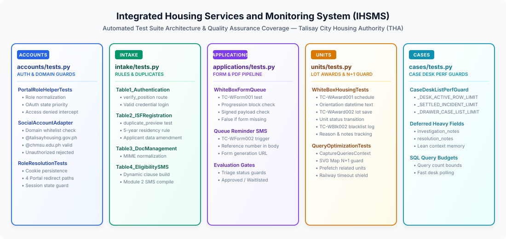

# 🧪 Testing & Quality Assurance Guide

> Complete testing and quality assurance guide explaining the automated unit test suite across `accounts`, `intake`, `applications`, `units`, and `cases`, external API mocking, query performance guards, and code coverage reporting for the **Integrated Housing Services and Monitoring System (IHSMS)** — Talisay City Housing Authority (THA).

🌐 **Live Demo:** [ihsms.up.railway.app](https://ihsms.up.railway.app/) | 📦 **Repository:** [TheUnshackled1/capstone-talisay_housing](https://github.com/TheUnshackled1/capstone-talisay_housing)

---

## 📋 Table of Contents

- [Testing Overview](#-testing-overview)
- [Running Unit Tests](#-running-unit-tests)
- [Test Suite Architecture](#-test-suite-architecture)
  - [1. Authentication & Portal Access Control (`accounts/tests.py`)](#1-authentication--portal-access-control-accountstestspy)
  - [2. Walk-In Intake, Duplication & Eligibility Rules (`intake/tests.py`)](#2-walk-in-intake-duplication--eligibility-rules-intaketestspy)
  - [3. Application Form Pipeline & PDF Queue (`applications/tests.py`)](#3-application-form-pipeline--pdf-queue-applicationstestspy)
  - [4. Housing Units, Lot Awarding & Query Optimization (`units/tests.py`)](#4-housing-units-lot-awarding--query-optimization-unitstestspy)
  - [5. Community Case Desk Performance Guards (`cases/tests.py`)](#5-community-case-desk-performance-guards-casestestspy)
- [Mocking External Services & APIs](#-mocking-external-services--apis)
  - [1. Semaphore SMS Gateway Mocking](#1-semaphore-sms-gateway-mocking)
  - [2. Google OAuth & SocialLogin Mocking](#2-google-oauth--sociallogin-mocking)
  - [3. Document Vault Scanned Uploads & MIME Types](#3-document-vault-scanned-uploads--mime-types)
- [Database Query Optimization & N+1 Guards (`CaptureQueriesContext`)](#-database-query-optimization--n1-guards-capturequeriescontext)
- [Code Coverage Analysis (`coverage.py`)](#-code-coverage-analysis-coveragepy)
- [Pre-Commit & System Health Checklist](#-pre-commit--system-health-checklist)

---

## 🧪 Testing Overview

The **Integrated Housing Services and Monitoring System (IHSMS)** relies on Django's built-in testing framework powered by Python's standard `unittest` library and isolated test runner database. Automated unit and integration tests verify:
- Role-based portal access controls (Second Member, Fourth Member, Ronda/Caretaker, and Field Staff).
- Strict Google Workspace domain whitelisting (`@talisayhousing.gov.ph`, `@chmsu.edu.ph`, and authorized `@gmail.com` accounts).
- Phonetic and exact duplicate applicant detection algorithms.
- Multi-layer eligibility criteria evaluation (5-year residency threshold, income caps, hazard tagging).
- Official 2-page THA application form generation prerequisites.
- Lot award state machine transitions and blacklist audit records.
- Database query count budgets (`CaptureQueriesContext`) to prevent N+1 query performance degradation on Railway cloud deployments.

---

## 🚀 Running Unit Tests

### Standard Test Execution

Execute the full automated test suite using Django's management CLI:

```powershell
python manage.py test
```

### Running Specific App Suites

To run tests for a single Django application:

```powershell
# Run Authentication & Portal Role tests
python manage.py test accounts

# Run Walk-in Intake & Eligibility tests
python manage.py test intake

# Run Form Pipeline & PDF Queue tests
python manage.py test applications

# Run Housing Unit & Lot Awarding tests
python manage.py test units

# Run Case Desk Performance Guard tests
python manage.py test cases
```

### Running Specific Test Classes or Methods

To run a specific test class (e.g., Google OAuth domain adapter tests):

```powershell
python manage.py test accounts.tests.SocialAccountAdapterTests
```

To run a single specific test method:

```powershell
# Verify pre-submit duplicate applicant detection
python manage.py test intake.tests.TestTable2_ISFRegistration.test_tc_wreg001_duplicate_preview

# Verify 5-year Talisay residency threshold check
python manage.py test intake.tests.TestTable2_ISFRegistration.test_tc_wreg003_residency_eligible
```

### Fast Test Execution (In-Memory / Parallel)

During active development, run tests with keepdb to avoid re-creating the test database schema on every iteration:

```powershell
python manage.py test --keepdb
```

---

## 📂 Test Suite Architecture


> ✏️ **Draw.io Source File:** [`docs/test_suite_architecture.drawio`](docs/test_suite_architecture.drawio) *(Editable in [Draw.io / app.diagrams.net](https://app.diagrams.net/))*

The test suite is organized across five modular test domains corresponding to core housing authority operational stages:

---

### 1. Authentication & Portal Access Control (`accounts/tests.py`)

Validates role normalization, portal access decorators, and domain authorization:

- **`PortalRoleHelperTests`**:
  - Validates role normalization mapping legacy positions (`caretaker`, `ronda`, `field`) into the unified `field_inspector` role.
  - Asserts OAuth state parameters take precedence over session keys (`PORTAL_ROLE_SESSION_KEY`) during Google OAuth callbacks.
  - Verifies position guards (`user_allowed_for_portal`) reject unauthorized portal access with explicit `Access Denied` error messages.
- **`SocialAccountAdapterTests`**:
  - Enforces domain whitelisting in `_email_allowed_domain`: permits `@talisayhousing.gov.ph`, `@chmsu.edu.ph`, and authorized developer `@gmail.com` accounts.
  - Asserts `ImmediateHttpResponse` redirect is raised when an unauthorized external Google account attempts authentication.
- **`LoginViewRoleResolutionTests`**:
  - Verifies the `LAST_PORTAL_ROLE_COOKIE` middleware correctly remembers the user's selected portal role across sessions.
  - Tests automatic routing to the correct portal dashboard upon successful authentication.

---

### 2. Walk-In Intake, Duplication & Eligibility Rules (`intake/tests.py`)

Validates citizen intake, duplicate prevention, and automated eligibility business logic:

- **`TestTable1_Authentication`**:
  - `test_tc_wauth001_verify_position`: Tests role-based route authorization decorator intercepting mismatched portal positions.
  - `test_tc_wauth002_login_verification`: Verifies valid credential session initialization.
- **`TestTable2_ISFRegistration`**:
  - `test_tc_wreg001_duplicate_preview`: Asserts the asynchronous duplicate preview API detects existing applicants sharing date of birth, surname, given name, and barangay.
  - `test_tc_wreg002_update_applicant`: Validates applicant profile data amendments, income adjustments, and database refreshes.
  - `test_tc_wreg003_residency_eligible`: Asserts that residency &lt; 5 years returns `False` and &ge; 5 years returns `True`.
  - **Household Member & Age Validation**: Verifies that household member birthdates (`hh_member_i_dob`) and biological sex are correctly parsed and saved, age is dynamically auto-calculated, and cross-generational relationship validation rejects invalid submissions (e.g., child older than applicant or parent younger than applicant).
- **`TestTable3_DocumentManagement`**:
  - `test_tc_wdoc002_normalize_content_type`: Tests MIME type normalization (`_normalize_blob_content_type`) for scanned document uploads (e.g., mapping `application/octet-stream` on `.pdf` files to `application/pdf`).
- **`TestTable4_EligibilityAndSMS`**:
  - `test_tc_weval002_situation_clause_sms`: Verifies dynamic SMS clause generation tailored to hazard area displacement reasons.
  - `test_tc_weval003_message_proceed_evaluation`: Validates Module 2 SMS message formatting containing the unique tracking reference (`THA-YYYY-XXX`).

---

### 3. Application Form Pipeline & PDF Queue (`applications/tests.py`)

Validates the evaluation queue, signed form requirements, and PDF generation gates:

- **`WhiteBoxFormQueueTests`**:
  - `test_tc_wform001_signed_application_validation`: Validates the form progression block (`applicant_has_signed_application_payload`), asserting that an applicant cannot advance without an uploaded, verified `doc_signed_application`.
  - `test_tc_wform002_form_queue_reminder_sms`: Asserts the form queue SMS reminder correctly includes the official application reference number and form generation instructions.

---

### 4. Housing Units, Lot Awarding & Query Optimization (`units/tests.py`)

Validates relocation site block/lot lifecycle transitions, orientation scheduling, and query budgets:

- **`WhiteBoxHousingTests`**:
  - `test_tc_waward001_orientation_formatting`: Validates that orientation date and time stamps are formatted cleanly (e.g., `May 20, 2026, 2:00 PM`) for citizen SMS notices.
  - `test_tc_waward002_lot_award_save`: Validates that creating an active `LotAward` binds the `Application` to the target `HousingUnit`.
  - `test_tc_wblk002_blacklist_save`: Verifies blacklist record creation, reason categorization (`fraud`, `abandonment`, `unauthorized_transfer`), and supporting notes.
- **`HousingUnitsMonitoringQueryTests`**:
  - Utilizes `CaptureQueriesContext` to guard against N+1 query regressions on the interactive SVG lot polygon map.
  - Verifies that prefetching related units and applications keeps query counts constant regardless of total relocation site units.

---

### 5. Community Case Desk Performance Guards (`cases/tests.py`)

Validates case management desk performance caps, query limits, and deferred field loading:

- **`CaseDeskListPerfGuardTests`**:
  - Enforces operational row limits: `_DESK_ACTIVE_ROW_LIMIT = 25`, `_SETTLED_INCIDENT_ROW_LIMIT = 50`, and `_DRAWER_CASE_LIST_LIMIT = 50`.
  - Asserts that large text fields (`investigation_notes`, `resolution_notes`) are deferred from initial desk queries via `_CASE_LIST_DEFER` to conserve memory on Railway Dynos.
  - Validates that desk polling versioning (`_bump_case_desk_data_version`, `_case_desk_poll_version`) operates with zero unnecessary database queries.

---

## 📧 Mocking External Services & APIs

During automated testing, no live network calls are made to external telecom or cloud providers. Services are mocked or configured to use local test backends:

### 1. Semaphore SMS Gateway Mocking

In production, SMS notifications are dispatched via the Semaphore SMS API. In test and local environments:

```python
# settings.py / test configuration
SMS_SERVICE = 'console'
```

Unit tests verify formatted SMS message strings directly via the workflow engine without network overhead:

```python
from django.test import TestCase
from intake.sms_workflow import lot_awarding_notify_body
from django.utils.timezone import make_aware
from datetime import datetime

class SMSWorkflowTest(TestCase):
    def test_orientation_sms_content(self):
        dt = make_aware(datetime(2026, 5, 20, 14, 0))
        body = lot_awarding_notify_body(orientation_at=dt)
        
        self.assertIn('May 20, 2026', body)
        self.assertIn('2:00 PM', body)
        self.assertIn('Talisay City Housing Authority', body)
```

### 2. Google OAuth & SocialLogin Mocking

Google OAuth callbacks and token exchanges are mocked using Python's standard `unittest.mock`:

```python
from unittest.mock import MagicMock
from django.test import RequestFactory, TestCase
from allauth.socialaccount.models import SocialLogin
from accounts.auth_portal import portal_role_for_oauth

class OAuthMockTest(TestCase):
    def test_oauth_portal_role_state(self):
        factory = RequestFactory()
        request = factory.get('/auth/google/login/callback/')
        
        # Mock SocialLogin state from Google OAuth payload
        sociallogin = MagicMock(spec=SocialLogin)
        sociallogin.state = {'portal_role': 'second_member'}
        
        resolved_role = portal_role_for_oauth(request, sociallogin)
        self.assertEqual(resolved_role, 'second_member')
```

### 3. Document Vault Scanned Uploads & MIME Types

The Dynamic Web TWAIN hardware scanner and Google Drive file streams are tested using synthetic binary payloads:

```python
from django.test import TestCase
from documents.views import _normalize_blob_content_type

class DocumentMIMETest(TestCase):
    def test_mime_type_normalization(self):
        # Hardware scanners often upload PDFs as generic octet-streams
        mime = _normalize_blob_content_type('application/octet-stream', 'barangay_clearance.pdf')
        self.assertEqual(mime, 'application/pdf')
```

---

## ⚡ Database Query Optimization & N+1 Guards (`CaptureQueriesContext`)

To protect Railway production servers from upstream timeouts on heavy interactive views (e.g., the SVG lot polygon map and community case desk), query count budgets are enforced using Django's `CaptureQueriesContext`:

```python
from django.test import TestCase
from django.test.utils import CaptureQueriesContext
from django.db import connection

class LotMapQueryBudgetTest(TestCase):
    def test_map_page_query_budget(self):
        # Populate test units and awards
        ...
        
        with CaptureQueriesContext(connection) as ctx:
            response = self.client.get('/housing-units/second_member/')
            self.assertEqual(response.status_code, 200)
            
        # Ensure query count does not exceed established budget (prevents N+1 loops)
        self.assertLessEqual(len(ctx.captured_queries), 8, 
            f"Query count regression detected: {len(ctx.captured_queries)} queries executed")
```

---

## 📊 Code Coverage Analysis (`coverage.py`)

Measure unit test code coverage across models, views, and workflow utilities:

### 1. Install `coverage`
```powershell
pip install coverage
```

### 2. Run Test Suite Under Coverage
```powershell
coverage run --source='.' manage.py test
```

### 3. View Terminal Summary Report
```powershell
coverage report -m
```

### 4. Generate Interactive HTML Coverage Report
```powershell
coverage html
```
Open `htmlcov/index.html` in your browser to inspect line-by-line coverage heatmaps and identify unexercised branches.

---

## 📋 Pre-Commit & System Health Checklist

Before submitting a Pull Request or pushing changes to production, execute the following verification steps:

```powershell
# 1. Verify Django configuration and model relationships
python manage.py check

# 2. Verify all database migrations are generated and applied
python manage.py makemigrations --check --dry-run
python manage.py migrate --plan

# 3. Execute the full automated test suite
python manage.py test

# 4. Validate static asset collection
python manage.py collectstatic --dry-run --noinput

# 5. Run Tailwind CSS production compilation
npm run build:tailwind
```
